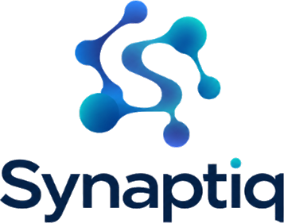

<p align="center">
  <picture>
    <source media="(prefers-color-scheme: dark)" srcset="assets/logo-dark.png">
    
  </picture>
</p>

<h3 align="center">No more waiting on the one person who knows.</h3>

<p align="center">
  <a href="https://albertogomezsoteres.github.io/synaptiq-prototypes/"><b>Live site</b></a>
  &nbsp;·&nbsp;
  <a href="https://albertogomezsoteres.github.io/synaptiq-prototypes/a/">Version A</a>
  &nbsp;·&nbsp;
  <a href="https://albertogomezsoteres.github.io/synaptiq-prototypes/b/">Version B</a>
  &nbsp;·&nbsp;
  <a href="https://albertogomezsoteres.github.io/synaptiq-prototypes/c/">Version C</a>
</p>

---

## The problem

At engineering-heavy companies, critical know-how lives with a few experts. Engineers can usually find *what* a system does, but not *why* it works that way. So they search, wait, or interrupt, and the same experts answer the same questions again and again.

Synaptiq closes that loop: it **spots the gap**, **finds the expert**, has them **validate once**, and makes the answer **reusable** for everyone after.

## Three versions, three hypotheses

Each version pairs one persona from our customer discovery with a different product approach. The class vote tells us which persona and which approach to lead with.

| | Version | Persona | Approach | Hypothesis | Validated if |
|---|---|---|---|---|---|
| **A** | [Ask Synaptiq](https://albertogomezsoteres.github.io/synaptiq-prototypes/a/) | New-to-system engineer | **Pull:** the engineer asks | Engineers trust and act on answers that show source, owner and available freshness information, and that admit "not found" and route the question. | Testers would act on the answer and see "not found" as helpful. |
| **B** | [Expert Inbox](https://albertogomezsoteres.github.io/synaptiq-prototypes/b/) | Go-to expert engineer | **Capture:** the expert validates | Experts prefer publishing one scoped explanation with evidence in view to repeating it in DMs. | Testers publish an explanation in under a minute and prefer it to a repeated DM. |
| **C** | [Context Briefing](https://albertogomezsoteres.github.io/synaptiq-prototypes/c/) | Deployment / cross-team engineer | **Push:** Synaptiq goes first | Engineers get unblocked faster when Synaptiq shows what changed, why, who worked on it, and what nobody wrote down, before they ask. | Testers make the right call on their first ticket without asking anyone. |

All three versions run on the same fictional company (Corvex Payments), with the same data and the same design, so the only variable is the product approach. The scenarios come from our customer interviews.

### What we deliberately left out

Live Slack/GitHub integrations, login, enterprise permissions and manager analytics remain out of scope. The demo now uses a real Gemini API, a shared knowledge store, document uploads and expert publishing.

## Try it

Open the site and check that the header says **Live AI · shared workspace**. A accepts free-form questions, B handles the actual routed questions, and C generates a briefing from the same current documents. **Clear this chat** clears A's conversation only. **Reset shared demo** removes uploaded documents and expert answers for everyone, after confirmation.

Use the files in `demo-files/` for the upload demonstration. They are not included in company knowledge until you upload them. PDF and PNG/JPG/WebP floor plans are passed to Gemini's visual input; text and DOCX files become text sources. Limit: 4 MB per file, 30 sources in the shared classroom workspace.

## Project structure

```
assets/          Logo files
docs/            Published site (GitHub Pages): one self-contained HTML file per page
src/
  shared.css     Design tokens and components used by every page
  shared.js      Shared interactions: streaming answers, guided steps, notifications
  index.html     Overview page
  a.html         Version A: Ask Synaptiq
  b.html         Version B: Expert Inbox
  c.html         Version C: Context Briefing
build.py         Builds docs/ from src/
tests/qa.py      Browser test that clicks through every flow
```

## Development

The frontend is plain HTML, CSS and JavaScript. The hosted demo uses the Cloudflare Worker API in `cloud/worker-api.js`, with D1 for shared records and R2 for uploaded PDFs/images. `server.py` provides the same interface locally using Python 3.12 and SQLite. The Gemini key stays in server-side configuration; it is never embedded in the published pages.

```bash
python3 build.py                     # rebuild docs/ after editing src/
python3 server.py                   # full app at http://localhost:8000
```

Backend tests (no API calls or third-party packages):

```bash
python3 -m unittest discover -s tests -p test_live.py -v
```

`tests/qa.py` covers the earlier scripted prototype; its selectors do not apply to the live UI. The live API and shared-state tests are in `tests/test_live.py`.

**Publishing:** GitHub Pages publishes `main` from `/docs`; its shared backend is configured in `src/config.js`. Rebuild with `python3 build.py` after frontend changes. The connection can also be supplied using **Connect workspace** or an `?api=https://...` query parameter. See [DEPLOYMENT.md](DEPLOYMENT.md) for hosting details and the demo script.

## Team

| Konur Nordberg | Alberto Gomez | Debshree Chowdhury | Xianyu Wang | Weikai Liao |
|:---:|:---:|:---:|:---:|:---:|
| CEO | CTO | CMO | CFO | COO |

<sub>MENG 570 · Fall 2026</sub>
